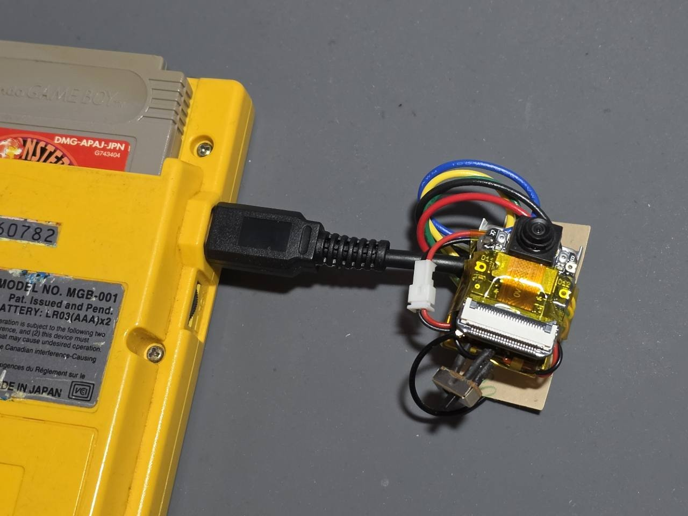

# GB AI Eye

Seeed Studio XIAO ESP32S3 Senseで写真を撮影し、OpenAIまたはGeminiにオーキド博士らしい日本語で講評させ、初代ポケモン赤の会話文字コードとしてGame Boyへ返すPlatformIOファームウェアです。

Game Boyのオーキドとの会話を起点にリンクケーブル経由で撮影を要求し、生成された講評を最大18文字×2行のゲーム内会話として表示します。



写真は動作確認に使用した実機試作です。カメラ、XIAO、レベルシフタ、LiPoを通信ケーブル側へまとめています。組み立て状態の写真は[公開用ハードウェアガイド](docs/hardware.md)に掲載しています。

> [!IMPORTANT]
> 本リポジトリはROM、セーブデータ、BGB本体、APIキーを配布しません。現在のGame Boy用コードは日本版『ポケットモンスター 赤』revision 1だけを対象とします。

## はじめに

- [最初から実機表示までの手順](docs/getting-started.md)
- [対応ROMとバイナリエディタの前提](docs/supported-rom.md)
- [部品、配線、電源](docs/hardware.md)
- [Fritzing配線図の作図仕様](docs/fritzing-wiring-spec.md)
- [写真からゲーム内表示までの仕組み](docs/architecture.md)
- [症状別トラブルシューティング](docs/troubleshooting.md)

バイナリエディタの導入は、おせけん氏の[初代ポケモン お手軽20分。バイナリエディタ作成チャート解説](https://youtu.be/qV1EJU6howc)を参照してください。動画の手順を完了した後、本リポジトリの285バイトの写真講評payloadを入力します。

## 必要なもの

- Seeed Studio XIAO ESP32S3 Sense
- 日本版『ポケットモンスター 赤』revision 1と対応する実機環境
- 加工できるGame Boy通信ケーブル
- 3信号分の5 V/3.3 Vレベル変換回路
- USB 5 V電源、または保護回路付き1セルLiPo
- Wi-FiとOpenAI APIまたはGemini APIのキー
- PlatformIOを動かせるPC
- はんだ付け工具、テスター、配線材

## 最短手順

1. [対応ROMの検査](docs/supported-rom.md)を行う。
2. `include/secrets.example.h`を`include/secrets.h`へコピーし、Wi-FiとAPIキーを設定する。
3. `include/app_config.h`でOpenAIまたはGeminiを選ぶ。
4. XIAOへ書き込み、USBシリアルから`c`を送って単体撮影を確認する。
5. 解説動画に従ってゲーム内バイナリエディタを導入する。
6. [入力表](analysis/oak-photo-link-input.md)の285バイトを入力して`DA00`を実行する。
7. [配線ガイド](docs/hardware.md)に従い、レベルシフタを介してGame BoyとXIAOを接続する。
8. オーキドに話しかけ、撮影からAI講評表示までを確認する。

Game Boyへ接続する前に、必ずXIAO単体の`c`試験を成功させてください。問題が起きた場合は[トラブルシューティング](docs/troubleshooting.md)の順序で片側ずつ切り分けます。

## 現在の実装

- XIAO ESP32S3 SenseのOV2640/OV3660カメラをSVGA（800×600）JPEGで撮影
- AIはOpenAI Responses APIの`gpt-5.6-sol`とGemini APIの`gemini-3.8-flash`をコード上で切替可能
- NTPで時刻を同期し、接続先に応じたルートCAでHTTPSサーバーを検証
- 回答を初代ポケモン日本版のかな文字コードへ変換
- Wi-Fi/API失敗、文字数違反、GB未対応文字を含む回答は最大3回再試行する
- 再試行後も表示条件を満たさない場合は、未対応文字を`？`にせず安全な定型講評へ差し替える
- 待機時はカメラとWi-Fiを停止し、撮影要求を受けた時だけ起動する
- 内蔵ユーザーLEDで待機、処理中、結果待ち、エラーを表示する
- Game Boyリンクポートの8 bit同期通信をGPIO割り込みで処理
- 欠落クロックを検出した場合は次の無通信区間でバイト境界を再同期する
- カメラ/API処理中は`BUSY`を返し、完了後に長さ・本文・XORチェックサムを送信
- CAPTUREを受信した割り込み内で前回の送信状態を即座に破棄し、`ふむふむ なるほど…`が最低4秒表示されるようBUSYを維持
- 認証情報未設定または処理失敗時は`NAK`を返す

## 設定とビルド

`include/secrets.h`へWi-Fiと使用するAPIのキーを設定します。APIキーを会話へ貼らず、ローカルのこのファイルだけに保存してください。

```cpp
#define WIFI_SSID "アクセスポイント名"
#define WIFI_PASSWORD "パスワード"
#define GEMINI_API_KEY "Google AI StudioのAPIキー"
#define OPENAI_API_KEY "OpenAI PlatformのAPIキー"
```

使用するAIは`include/app_config.h`の1行で選びます。現在はOpenAIが選択されています。

```cpp
constexpr AiProvider AI_PROVIDER = AiProvider::kOpenAI;  // OpenAI
// constexpr AiProvider AI_PROVIDER = AiProvider::kGemini;  // Geminiへ戻す場合
```

OpenAIでは画像入力対応の`gpt-5.6-sol`をResponses APIへ送り、`reasoning.effort`は`none`、画像detailは`high`に設定しています。`low`では512ピクセルを超える画像が強く縮小されるため、商品名や箱の小さな図柄を読む用途には使用しません。

プロンプトには、回答が初代ポケモン赤を動かすGame Boy実機上でオーキド博士の台詞として表示されることを明記しています。小型カメラの色かぶり、暗さ、低解像度、ピントずれを考慮し、不明瞭な色や文字を断定せず、確認できる輪郭・図柄・文字から説明します。箱・商品パッケージ・ポスター・画面と実物を区別し、読める商品名・作品名・キャラクター名を一般名より優先します。固有名詞はひらがなへ崩さず、Game Boyで表示可能なカタカナへ変換します。特定の作品や商品の例は入れていないため、指示文の固有名へ回答が引き寄せられません。

OpenAIが`credit_balance_exhausted`、`insufficient_quota`、`billing_hard_limit_reached`を返した場合は、待っても復旧しないため再試行せずNAKへ移ります。OpenAI Platform側でAPIクレジットを追加してから再実行してください。通常のレート制限429は従来どおり再試行します。

ビルドと書き込みは次のコマンドです。

```powershell
pio run
pio run -t upload
pio device monitor -b 115200
```

認証情報を含む`include/secrets.h`は`.gitignore`へ登録済みです。雛形は`include/secrets.example.h`にあります。

Game Boyを接続する前の単体試験では、シリアルモニターから`c`を送信します。撮影、AI応答、変換後のGame Boy用バイト列が順に表示されます。

起動ログの`Game Boy text normalization: pass`は、Unicodeの合成済み濁音と基底かな＋結合濁点／半濁点が同じGame Boy表示になることを検査した結果です。改行位置はUTF-8のコードポイント数ではなく、正規化後の表示文字数で決め、18文字目の後へ改行を入れて最大36文字を2行に表示します。変換後の本文が通信上限63バイトを超える回答は再生成します。

Game Boy側へ入力する任意コードは[オーキド写真講評版・バイナリエディタ入力表](analysis/oak-photo-link-input.md)にあります。通常の会話枠を描く処理を含む6ブロックと、全285バイトの`アドレス:値`一覧を収録しています。最大48バイト版からは`DB38`の1バイトだけ、旧280バイト版からは同ページ記載の22バイトで更新できます。処理の仕組みは[プログラム解説書](analysis/oak-photo-link-program-guide.md)で、会話ポインタ、テキスト命令、シリアルルーチン、レジスタ用途まで説明しています。

## XIAOのステータスLED

XIAO ESP32S3 Senseの内蔵ユーザーLED（GPIO21）で状態を表示します。LEDはアクティブLOWですが、配線や外付け部品は不要です。

| LED表示 | 状態 |
|---|---|
| 2秒ごとに短く1回点灯 | 待機中・撮影可能 |
| 0.2秒間隔で点滅 | カメラ起動・Wi-Fi接続待ち |
| 短く2回点滅を繰り返す | Wi-Fi接続済み・AI応答待ち |
| 点灯したまま | 講評を生成済み・Game Boyの受信待ち |
| 3回点滅を繰り返す | 設定不足、撮影失敗、通信/APIエラー |

結果をGame Boyへ送り終えると待機表示へ戻ります。エラー表示は、次の撮影要求を受けるまで保持します。

## Game Boyとの配線

XIAOは3.3 Vロジックです。Game Boyリンクポートとの間に、プッシュプル信号へ対応した5 V/3.3 Vレベルシフタを入れてください。Game BoyのVCC端子からXIAO本体へ給電せず、XIAOはUSB 5 VまたはBAT端子の1セルLiPoから独立給電します。電源付きレベルシフタをLiPo運用する場合だけ、GB端子1のVCCをシフタのHV/VCCBへ接続できます。XIAOの3V3をLV/VCCAへ接続し、GB、シフタ、XIAOのGNDを共通にします。電源容量とコンデンサの詳細は[電源・発熱・配線](docs/power-and-wiring.md)を参照してください。

| Game Boyリンク端子 | 信号 | レベルシフタ | XIAO ESP32S3 Sense |
|---|---|---|---|
| 2 | SOUT | 5 V → 3.3 V | D1 / GPIO2 |
| 3 | SIN | 3.3 V → 5 V | D3 / GPIO4 |
| 5 | SCK | 5 V → 3.3 V | D0 / GPIO1 |
| 6 | GND | 直結 | GND |
| 1 | VCC | シフタのHV/VCCB電源だけに使用可 | XIAO本体へは接続しない |

電源付きレベルシフタでは、信号3本とGNDだけでは動作しません。`LV/VCCA = XIAO 3V3`、`HV/VCCB = GB端子1の5V`、両側GND共通とし、`OE`端子がある製品はデータシートどおり有効化してください。USBの5VとGB端子1を同じ電源線へ直結しません。

端子番号はGame Boy本体のソケットを外側から見た番号です。リンクケーブルを加工する場合、ケーブル両端ではSOUTとSINが交差している点に注意してください。

## 通信の流れ

1. Game Boyが`43`を送信して撮影を要求する。同時にXIAOから`06`を受信する。
2. XIAOは別タスクで撮影と選択中のAI API呼び出しを開始する。
3. Game Boyは1フレーム程度の間隔でダミー`00`を送る。処理中の応答は`17`。
4. 完了すると、応答が`80 | 長さ`になる。長さは1～63バイト。
5. 続けてダミー`00`を送ると、本文、XORチェックサムの順に受信する。
6. 送信終了後のXIAO応答は`06`へ戻る。失敗時は`15`。

受信した本文は表示文字だけです。Game Boy側では先頭にテキストコマンド`00`、末尾に`57`を付けて表示します。詳細は`docs/xiao-gameboy-protocol.md`を参照してください。

## 検証状況

PlatformIO Espressif 32 6.9.0、Arduino ESP32 core 2.0.17でビルドし、COM5のXIAOへ書き込み済みです。

```text
RAM:   50,484 / 327,680 bytes (15.4%)
Flash: 958,345 / 3,145,728 bytes (30.5%)
```

Sol選択版の最新版は958,704 bytesの`firmware.bin`（SHA-256 `0A2B7EABE4418596925A2FEE1F5F1986E609A5F110012F600711A77E9357D5D2`）です。COM5へ書き込み、起動ログでOpenAI / `gpt-5.6-sol`の選択と文字正規化自己診断`pass`を確認しました。以前のSVGA実写試験では、パッケージと印刷された人物を区別し、固有名をカタカナで維持してGame Boy用文字列へ変換できています。

Gemini安定化版では、実機Game Boyとの総合試験で撮影、Gemini応答、講評表示に成功しています。USBシリアルにはGB受信総数、最終受信値、異常バイト数、撮影セッション、Wi-FiチャンネルとRSSIを表示します。

待機時はカメラとWi-Fiを停止します。以前の温度試験では内部温度表示が待機時約51 ℃、20秒のWi-Fi接続試行中に約59 ℃、停止後に約55 ℃へ低下しました。内部温度は基板表面温度ではなく変化を見るための目安です。

最新版の再試行試験では、Wi-Fi接続失敗時に3回の無線部再初期化と段階的待機を行い、その後NAKへ移ることを確認しました。試験時のアクセスポイントは3回とも接続タイムアウトだったため、最新版でのGemini HTTP再試行経路は次回アクセスポイント接続時に確認します。

Game Boy側はBGBで、XIAO未接続時の自然な失敗台詞と、リンク相手から模擬講評を受け取る成功経路も確認済みです。

組み込み済みのGTSおよびISRGルートCAには有効期限があります。OpenAIまたはGoogle側の証明書チェーンが変わった場合は`include/google_trust_anchors.h`と`include/openai_trust_anchors.h`を更新してください。

## 権利関係

本プロジェクトは非公式の技術デモであり、任天堂、株式会社ポケモン、ゲームフリークその他の権利者による公式製品・公式プロジェクトではありません。ゲームソフト、ROM、セーブデータ、エミュレータは同梱しません。
