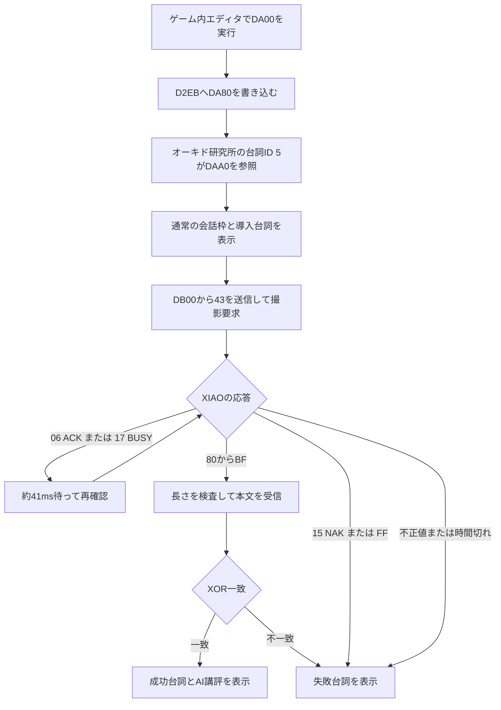

# オーキド写真講評版プログラム解説書

## 1. このプログラムの目的

この285バイトのプログラムは、日本版『ポケットモンスター 赤』revision 1のWRAMへゲーム内バイナリエディタで入力し、オーキド研究所のオーキドの台詞ID 5だけを写真講評処理へ差し替えるものである。

処理は次の三つに分かれている。

1. オーキド研究所の会話ポインタをWRAM上の新しい表へ向ける。
2. 通常の会話枠と撮影待ち台詞を表示する。
3. Game BoyリンクポートからXIAOへ撮影を要求し、AI講評を受信して会話として表示する。

ROMを書き換える処理やセーブデータを更新する処理は含まない。対象ROM、会話ルーチン、バイナリエディタの配置に依存するため、他の版へアドレスをそのまま流用することはできない。

正確な入力値は[バイナリエディタ入力表](oak-photo-link-input.md)、機械語と逆アセンブルの対応は[注釈付きアセンブリ](../payloads/oak-photo-link.asm)にある。本書は、それらの値がどのように一つのプログラムとして動くかを説明する。

## 2. 全体の処理



Game Boyが通信のクロックを生成するマスターで、XIAOは応答するスレーブである。通信中もGame Boyは通常のテキスト処理の中におり、成功時または失敗時に表示するテキストの先頭アドレスを`HL`で返すことで、既存の会話エンジンへ処理を戻す。

## 3. WRAM上の配置

| 範囲 | 長さ | 内容 |
|---|---:|---|
| `DA00`～`DA08` | 9バイト | 会話ポインタを書き換えるインストーラ |
| `DA80`～`DA89` | 10バイト | オーキド研究所用の新しい台詞ポインタ表 |
| `DAA0`～`DADA` | 59バイト | 会話枠の初期化、導入台詞、撮影待ち台詞 |
| `DB00`～`DBA0` | 161バイト | シリアル通信、待機、本文受信、検査 |
| `DC20`～`DC38` | 25バイト | 通信失敗時の台詞 |
| `DC50`～`DC64` | 21バイト | 通信成功時の前置き |
| `DC65`～`DCA3` | 最大63バイト | XIAOから受信したAI講評 |
| `DCA4` | 1バイト | 講評末尾へ実行時に追加する終了コード`57` |
| `DCE0`以降 | 使用しない | 導入済みバイナリエディタ本体 |

入力するのは`DC64`までの六つのブロック、合計285バイトである。`DC65`～`DCA4`は受信バッファなので、バイナリエディタで事前入力する必要はない。

各ブロック間の未使用領域は、機能ごとの配置を分け、既存のバイナリエディタがある`DCE0`へ到達しないための余白である。生成ツールは各ブロックの重複と`DCE0`以降への侵入を検査する。

## 4. `DA00`: 会話ポインタのインストーラ

```asm
DA00: 21 EB D2    ld hl, $D2EB
DA03: 3E 80       ld a, $80
DA05: 22          ld [hli], a
DA06: 36 DA       ld [hl], $DA
DA08: C9          ret
```

`D2EB-D2EC`には、現在のマップで使用する台詞ポインタ表のアドレスが入っている。Game Boy CPUは16ビット値を下位バイトから置くリトルエンディアンなので、`80 DA`を書き込むと値は`DA80`になる。

`ld [hli], a`は`[HL]`へ書き込んだ後に`HL`を1増やす命令である。そのため、`D2EB=80`、`D2EC=DA`を短いコードで連続して設定できる。

最後の`ret`は、バイナリエディタがスタックへ用意した復帰先へ戻る。導入済みエディタではSELECT単独実行時の復帰先が`DCE3`であるため、`DA00`を実行した後もエディタ操作へ戻れる。

このインストーラは写真撮影のたびに実行するものではない。`D2EB-D2EC`が`DA80`を保持している間は、オーキドへ話しかけるだけで新しい会話が始まる。

## 5. `DA80`: 台詞ポインタ表

```asm
DA80: 0C 4B    dw $4B0C   ; 台詞ID 1
DA82: 9B 4B    dw $4B9B   ; 台詞ID 2
DA84: AC 4B    dw $4BAC   ; 台詞ID 3
DA86: BD 4B    dw $4BBD   ; 台詞ID 4
DA88: A0 DA    dw $DAA0   ; 台詞ID 5
```

オーキド研究所の元の台詞表からID 1～4のポインタをそのまま残し、ID 5だけをWRAM上の`DAA0`へ変更している。これにより、図鑑評価など同じマップ内の別の台詞を巻き込まず、対象のオーキド会話だけを差し替えられる。

先頭四つの`4Bxx`は、その会話が実行されるROMバンク内の元テキストを参照する。五つ目だけはCPUアドレス空間のWRAMを指す`DAA0`である。会話エンジンはポインタの参照先がROMかWRAMかを区別せず、同じ文字列として処理できる。

## 6. `DAA0`: 会話枠と導入台詞

### 6.1 通常の会話枠を準備する

`DAA0`の`08`は、後続をテキストではなくインライン機械語として実行させるテキスト命令である。

```asm
DAA0: 08             db $08
DAA1: 3E 01          ld a, $01
DAA3: EA EA D0       ld [$D0EA], a
DAA6: CD 1E 31       call $311E
DAA9: CD AB 0E       call $0EAB
DAAC: CD F5 3D       call $3DF5
DAAF: 01 B9 C4       ld bc, $C4B9
DAB2: 21 B6 DA       ld hl, $DAB6
DAB5: C9             ret
```

各処理の役割は次のとおりである。

| 処理 | 役割 |
|---|---|
| `[$D0EA] = 01` | 通常のテキストボックス描画を有効にする |
| `call $311E` | 標準会話枠を描く |
| `call $0EAB` | スプライト表示を更新する |
| `call $3DF5` | 3フレーム待ち、描画を安定させる |
| `BC = C4B9` | 標準会話枠の本文開始位置を設定する |
| `HL = DAB6` | 次に解釈するテキスト本文を指定する |
| `ret` | テキスト命令処理へ戻る |

枠描画を省くと、本文だけが背景へ直接表示されたり、前の画面要素が残ったりする。この初期化はROMの通常会話が行う順序に合わせている。

### 6.2 表示する本文

`DAB6`以降は日本版初代ポケモンの文字コードとテキスト制御コードである。

```text
おお！ しゃしんを
みせて くれるのか？

ふむふむ なるほど…
```

使用している主な制御コードは次のとおりである。

| 値 | 意味 | このプログラムでの用途 |
|---|---|---|
| `00` | インライン本文開始 | 後続を表示文字列として扱う |
| `4F` | 標準会話枠の2行目へ移動 | 台詞を2行に分ける |
| `50` | 現在の文字列を終了 | 待機台詞の後で本文を閉じる |
| `51` | 次ページへ進む | 導入台詞と待機台詞、成功前置きとAI講評を分ける |
| `57` | 会話を完了 | 成功または失敗台詞の末尾 |
| `08` | インライン機械語を実行 | 枠初期化と撮影通信を呼び出す |

待機台詞の後は`50 08`と続き、もう一度インライン機械語へ入り、`jp $DB00`でシリアル通信処理へ移る。

## 7. XIAOとの通信形式

Game BoyからXIAOへ送る制御値と、XIAOから返る状態値は次のとおりである。

| 値 | 名前 | 意味 |
|---|---|---|
| `43` | CAPTURE | 新しい撮影を要求する |
| `00` | DUMMY | XIAOの次の応答を受け取るための送信値 |
| `06` | ACK | 待機中、要求受付、または送信完了 |
| `15` | NAK | 撮影、設定、ネットワーク、APIなどの失敗 |
| `17` | BUSY | 撮影またはAI処理中 |
| `80`～`BF` | DATA_HEADER | 下位6ビットが本文バイト数 |
| `FF` | DISCONNECTED | 入力がプルアップされた未接続時の代表値 |

結果フレームは次の形式である。

```text
80 | length, text[0], text[1], ... text[length-1], xor
```

`length`は1～63で、最後の`xor`は本文全バイトの排他的論理和である。長さを含む先頭バイトとチェックサム自身はXORへ含めない。

Game Boyのシリアル通信は全二重なので、`43`を送っている同じ1バイト転送中に、XIAOは事前に準備していた値を返す。XIAOが`43`を解釈した結果は次の転送から反映される。そのためGame Boy側は最初の戻り値だけで完了を判断せず、`00`を定期的に送りながら状態を確認する。

## 8. `DB00`: 撮影要求と状態待ち

プログラムの主要部分を擬似コードにすると次のようになる。

```text
response = SerialByte(43)
if 通信タイムアウト or response == 15 or response == FF:
    失敗台詞へ

remaining = 0E10
while remaining != 0:
    約41ms待つ
    response = SerialByte(00)

    if 通信タイムアウト or response == 15 or response == FF:
        失敗台詞へ
    if response == 17 or response == 06:
        remainingを1減らして続行
    else if responseの上位2ビット != 10:
        失敗台詞へ
    else:
        length = response & 3F
        if length == 0 or length >= 64:
            失敗台詞へ
        本文受信へ

失敗台詞へ
```

`DE`を状態待ちの残り回数、`A`を受信値として使用する。`DE=0E10`は10進数で3600である。1回の`PollDelay`は約41msなので、XIAOから完了応答が来ない場合はおよそ148秒で失敗へ移る。実際の時間は割り込みや周辺処理によってわずかに変わる。

ヘッダー判定では、受信値を一度`C`へ保存し、`A & C0`が`80`かを調べる。これにより`80`～`BF`だけをデータヘッダーとして受け入れる。その後`C & 3F`で長さを取り出し、0を拒否して1～63だけを受け入れる。

## 9. `DB41`: 本文受信とXOR検査

本文受信時のレジスタ用途は次のとおりである。

| レジスタ | 用途 |
|---|---|
| `HL` | 次に書き込む受信バッファのアドレス。初期値`DC65` |
| `C` | 残り本文バイト数 |
| `D` | 受信済み本文のXOR |
| `A` | 今回受信した1バイト |

ループ本体は次の処理を行う。

```asm
DB41: AF          xor a              ; 00を送る
DB42: CD 65 DB    call SerialByte    ; A = XIAOからの受信値
DB45: 38 1A       jr c, Failure      ; 1バイト転送の時間切れ
DB47: 22          ld [hli], a        ; 本文を保存しHLを進める
DB48: AA          xor d              ; 新しい累積XOR
DB49: 57          ld d, a
DB4A: 0D          dec c
DB4B: 20 F4       jr nz, $DB41
```

本文をすべて受信した後、もう一度`00`を送ってXIAO側のチェックサムを受け取る。受信値`A`と累積値`D`が一致しなければ失敗となる。

一致した場合は、本文の直後へ`57`を書き込む。本文が最大63バイトなら、`DC65`～`DCA3`へ本文が入り、`DCA4`へ`57`が入る。これで受信バッファ自体が、そのまま会話エンジンで表示できる終了付き文字列になる。

最後に`HL=DC50`として`ret`する。`DC50`の成功前置きが`51`で終わるため、会話エンジンは次ページとして直後の`DC65`からAI講評を表示する。

## 10. `DB65`: 1バイト送受信ルーチン

`SerialByte`は、呼び出し前の`A`を送信し、受信した値を`A`で返す。失敗はCarryフラグで通知する。

### 10.1 転送開始

```asm
di
ldh [$FF01], a   ; SBへ送信値を設定
ld a, $81
ldh [$FF02], a   ; 内部クロックで転送開始
```

`FF01`はシリアルデータレジスタSB、`FF02`はシリアル制御レジスタSCである。SCへ`81`を書くと、転送開始ビットを立て、Game Boy自身の内部クロックを選ぶ。

転送中は`di`でCPU割り込みを止める。シリアル回路自体は動作するため、CPUは割り込みに処理を奪われずSCの完了ビットを監視できる。

### 10.2 1バイト単位のタイムアウト

`B=FF`からカウントダウンし、SCのbit 7が0になるのを待つ。通常のDMG転送は8192Hzで8ビット、約0.98msで完了する。このループの上限は概算約2.7msなので、正常転送には余裕があり、クロックが完了しない異常時には会話全体を永久停止させない。

時間切れではSCへ`01`を書いて転送開始ビットを下ろし、IFレジスタ`FF0F`のシリアル割り込み要求bit 3を消す。その後`scf`でCarryを1にして戻る。

### 10.3 正常終了

正常終了時はSBから受信値を読み、いったんスタックへ保存する。IFのbit 3を消す処理で`A`を使用するためである。その後受信値を`A`へ戻し、`and a`でCarryを0にして返す。

返る直前には`B=20`の短いループを入れている。これは約504 CPUクロック、約0.12msに相当し、XIAOが次の送信バイトを準備する時間を確保する。旧280バイト版から285バイト版へ増えた5バイトは、この待機処理である。

## 11. `DB96`: 状態確認間隔

`PollDelay`は`BC`をスタックへ保存し、`BC=1800`から0まで減らす。

```asm
push bc
ld bc, $1800
.loop
dec bc
ld a, b
or c
jr nz, .loop
pop bc
ret
```

概算で約172,000 CPUクロック、約41msとなる。撮影とAPI処理には数秒以上かかるため、毎バイト連続でポーリングせず、Game BoyとXIAOの負荷を抑えている。

`push bc`と`pop bc`を使うのは、呼び出し元が応答値や本文長の保存に`C`を使用するためである。

## 12. 成功・失敗時のテキスト

### 12.1 失敗時

`Failure`は`HL=DC20`を返す。`DC20`には次の台詞と終了コード`57`がある。

```text
むむ？ しゃしんが
うまく みえんようじゃ…
```

この経路へ入る条件は次のとおりである。

- 1バイト転送が完了しない
- XIAOが`15`を返す
- 未接続を示す`FF`を受信する
- ACK/BUSY以外で、データヘッダーでもない値を受信する
- 本文長が0、または1～63の範囲外
- 本文受信中に転送が失敗する
- XORチェックサムが一致しない
- 約148秒の状態待ちが終了する

### 12.2 成功時

`ResultScript`は次の前置きを表示する。

```text
うむ！ これは
いい しゃしんじゃ！
```

末尾は会話終了の`57`ではなく次ページの`51`である。次のアドレス`DC65`に受信済みAI講評が連続しているため、ボタンを送るとAI講評のページへ進む。

## 13. 機械語入力を読むための要点

入力表は1バイト単位だが、CPUは複数バイトを一つの命令として解釈する。

| 機械語例 | 命令 | 意味 |
|---|---|---|
| `21 EB D2` | `ld hl,$D2EB` | 16ビット即値をHLへ入れる |
| `3E 43` | `ld a,$43` | 8ビット即値をAへ入れる |
| `CD 65 DB` | `call $DB65` | 戻り先をスタックへ積んでサブルーチンを呼ぶ |
| `C3 00 DB` | `jp $DB00` | 無条件で別アドレスへ移る |
| `C9` | `ret` | スタックの戻り先へ戻る |
| `38 5A` | `jr c,+$5A` | Carryが1なら相対移動する |
| `28 56` | `jr z,+$56` | Zeroが1なら相対移動する |
| `20 F4` | `jr nz,-$0C` | Zeroが0なら後方へ相対移動する |

16ビットの絶対アドレスはリトルエンディアンで格納される。たとえば`call $DB65`は`CD 65 DB`、`ld hl,$DC65`は`21 65 DC`となる。

`jr`の2バイト目は移動先の絶対アドレスではなく、命令直後からの符号付き差分である。プログラムの途中へバイトを追加すると、後続ルーチンのアドレスだけでなく、それらを指す`call`や`jr`も更新する必要がある。入力値を手作業でずらさず、生成ツールから作り直す理由がここにある。

## 14. 生成ツール

[build-oak-photo-payload.cjs](../tools/build-oak-photo-payload.cjs)が、このプログラムの原本である。次の処理を自動化している。

- 日本語文字列をXIAO側と同じ文字表でGame Boy用バイトへ変換
- ラベルから`call`、`jp`、`ld hl`の16ビットアドレスを解決
- `jr`の相対変位を計算し、±128バイト以内か検査
- 六つの入力ブロックが互いに重ならないことを検査
- 受信バッファを含めて`DCE0`のバイナリエディタへ重ならないことを検査
- 注釈付きアセンブリ、ブロック一覧、1バイト単位CSV、入力用Markdownを生成

台詞、待機時間、ルーチン配置を変更する場合は、生成済みの機械語を直接編集するより、生成ツールを変更して全出力を再生成する方が安全である。

## 15. XIAO側との分担

Game Boy側はカメラ、Wi-Fi、HTTPS、AI APIを扱わない。担当範囲は、撮影要求、状態待ち、最大63バイトの受信、XOR検査、ゲーム内表示だけである。

XIAO側は次を担当する。

- `43`を受けてカメラを起動
- 写真をOpenAIまたはGeminiへ送信
- 回答を15～36文字かつ表示可能文字へ制限し、変換後63バイト以内か検査
- 日本版初代ポケモンの文字コードへ変換
- Unicodeの基底かな＋結合濁点／半濁点を、ゲーム上の濁音1文字へ正規化
- 正規化後の18表示文字目の後に2行目移動コード`4F`を挿入
- 長さ、本文、XORをフレームとしてGame Boyへ送信
- 連続実行時の旧フレーム破棄と、欠落クロック後の再同期

この分担により、GB側コードは285バイトに収まり、ネットワーク処理や画像処理の変更はXIAO側ファームウェアだけで行える。

初代ポケモンの文字描画では、単独の濁点`E5`と半濁点`E4`は現在位置の上段へ描かれ、カーソルを進めない。そのため専用の1バイト文字がない「ペ」などを分解表現する場合は、`E4`、`ヘ`の順で送る必要がある。逆の`ヘ`、`E4`では、`ヘ`を描いた後にカーソルが進むため、半濁点だけが右へ1マスずれる。XIAO側エンコーダーはこの順序も保証する。

## 16. 検証済みの範囲

開発時には次の二つのBGB再現試験に合格している。試験用セーブステートはROM由来データを含むため公開リポジトリには収録しない。

- ゲーム内エディタ操作で285バイトを入力し、未接続時に失敗台詞へ移る試験
- BGBを2台接続し、ACK、BUSY、本文ヘッダー、本文、XORを受ける試験。旧上限を超える49通信バイトを使い、半濁点を含む36表示文字が18文字ずつ2行に表示されることを確認した

成功試験では受信バッファが送信内容と一致し、試験後のSRAM SHA-256も元SAVと一致した。実機では、XIAOによる撮影、OpenAI応答、Game Boy画面への講評表示と連続実行が確認されている。

## 17. 変更時に守る条件

- `D2EB-D2EC`やROMルーチンのアドレスは対象ROM revision 1固有として扱う。
- `DC65`から本文63バイト、続く`DCA4`の終了コードまでを空ける。
- `DCE0`以降の導入済みバイナリエディタへ書き込まない。
- Game Boy側の制御値を変える場合はXIAO側プロトコルも同時に変える。
- 本文最大長を増やす場合は、ヘッダーの6ビット長、表示領域、バッファ終端、エディタとの境界をすべて再検査する。
- コードサイズを変えた後は相対ジャンプ、絶対呼び出し、入力表、BGB成功・失敗試験を再生成・再実行する。
