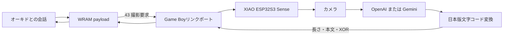
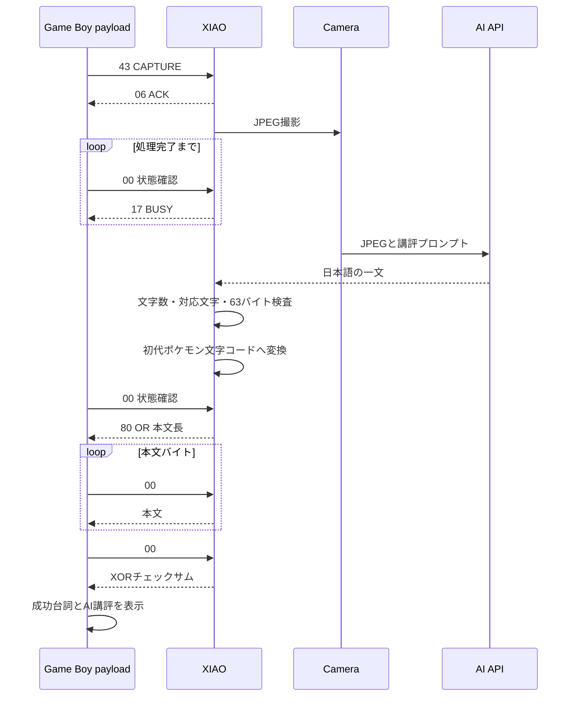

# アーキテクチャ

## 全体像

GB AI Eyeは、初代ポケモンの会話処理、Game Boyリンク通信、XIAOのカメラ、クラウドAIを一つの往復処理としてつないでいる。



Game Boyは画像やHTTPSを扱わない。XIAOはゲームの内部状態を変更しない。両者は撮影要求と表示用文字列だけをリンクポートで交換する。

## 1回の撮影



## Game Boy側

ゲーム内バイナリエディタで285バイトのpayloadをWRAMへ配置する。`DA00`のインストーラがオーキド研究所の会話ポインタを差し替える。

会話が始まると通常の枠を描画し、「ふむふむ なるほど…」を表示してから`43`を送る。AI処理中は約41 ms間隔で状態を確認し、最大63バイトの本文とXORを受信する。チェックに成功した本文だけを会話エンジンへ渡す。

詳しいメモリ配置と命令は[プログラム解説書](../analysis/oak-photo-link-program-guide.md)にある。

## XIAO側

待機中はカメラを初期化せず、Wi-Fiも停止する。`43`を受信すると前回の未送信フレームを破棄し、別タスクで次を行う。

1. カメラを初期化してSVGA JPEGを撮影する。
2. Wi-Fiへ接続し、時刻を同期する。
3. HTTPSで選択中のAI APIへ画像とプロンプトを送る。
4. 回答を15～36表示文字、対応文字だけに制限する。
5. 濁点・半濁点を正規化し、18文字目の後へ改行コードを入れる。
6. Game Boy文字コードへ変換し、変換後63バイト以内か確認する。
7. ヘッダー、本文、XORを割り込み側へ一括公開する。
8. カメラとWi-Fiを停止する。

AI回答が条件を満たさない場合は同じ画像で最大3回書き直しを求める。それでも不適合なら表示可能な定型講評を使う。

## 通信フレーム

```text
+----------------+-------------------+----------------+
| 80 | length    | text[length]      | xor checksum   |
+----------------+-------------------+----------------+
```

`length`は1～63。checksumは本文全バイトのXORである。本文は日本版初代ポケモンの文字コードで、18文字を超える場合は2行目移動コード`4F`を含む。

Game Boyがクロックマスターで、XIAOはGPIO割り込みを使うスレーブである。欠落エッジを検出すると現在のバイトを捨て、3 ms以上の無通信後にバイト境界を取り直す。詳細は[XIAO・Game Boy間プロトコル](xiao-gameboy-protocol.md)を参照する。

## 変更しやすい部分

- AIプロバイダとモデル: `include/app_config.h`
- AIへの指示: `src/camera_gemini.cpp`
- 日本語文字変換: `src/gameboy_text.cpp`
- XIAO側リンク処理: `src/gameboy_link.cpp`
- Game Boy payload生成: `tools/build-oak-photo-payload.cjs`
- Game Boy入力値: `analysis/oak-photo-link-input.md`

Game Boy本文長を変更する場合は、XIAOのフレーム上限、Game Boyの比較値、受信バッファ終端、バイナリエディタとの境界を同時に検査する。
