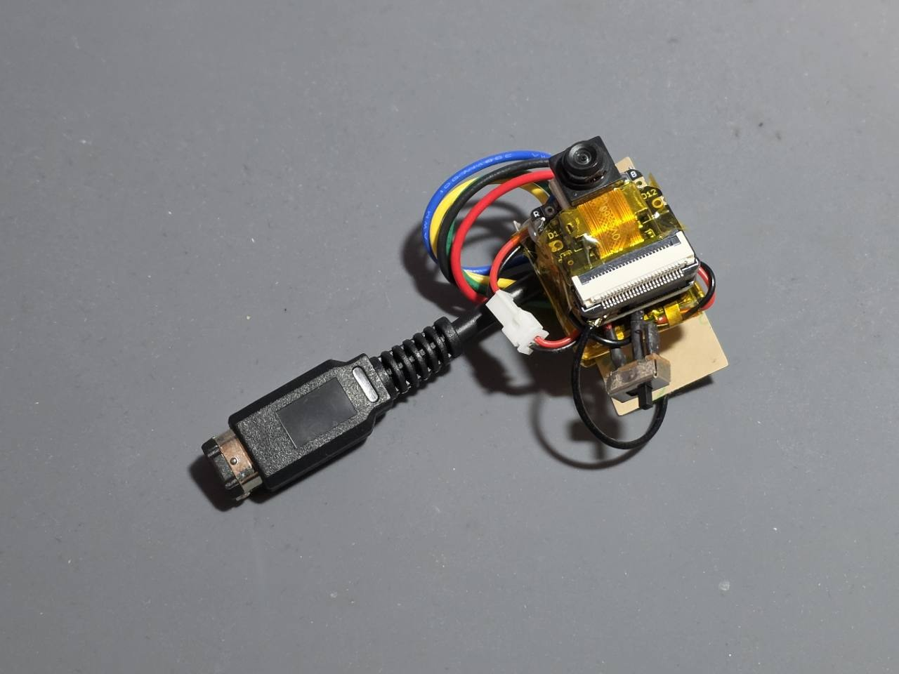
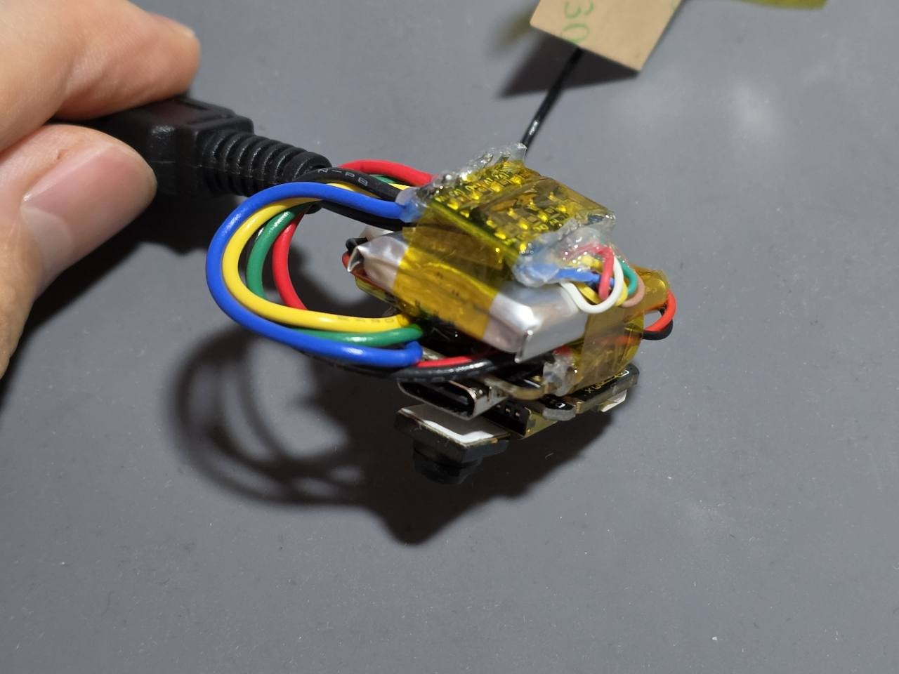
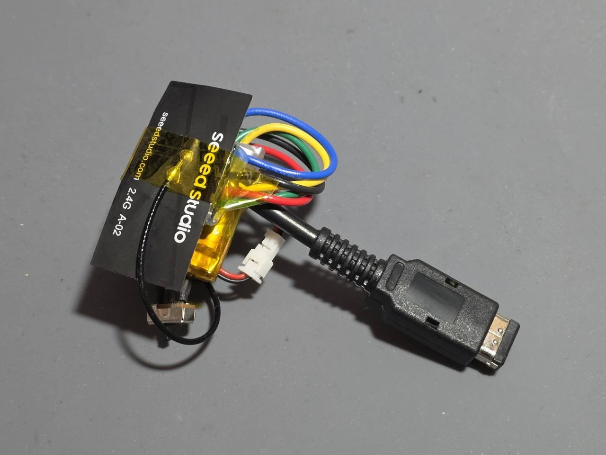
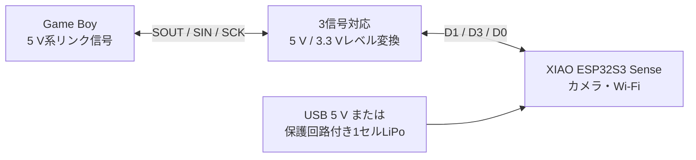

# 公開用ハードウェアガイド

## 実機試作

次の写真は、通信とAI講評表示まで動作確認した実機試作である。カメラが前を向くようにXIAO ESP32S3 Senseを配置し、レベルシフタ、1セルLiPo、電源スイッチを背面へまとめている。







この状態は機能確認用の試作であり、露出した基板、LiPo、はんだ面をテープで仮固定している。持ち運びや長期使用を想定する場合は、レンズを塞がないケース、ケーブルの引張対策、基板裏面の絶縁、LiPoを圧迫しない固定方法を追加する。

清書用の端子対応、図面配置、配色、注記は[Fritzing配線図の作図仕様](fritzing-wiring-spec.md)にまとめている。

## 構成

Game BoyのリンクポートとXIAO ESP32S3 Senseはロジック電圧が異なるため、3本の通信信号をレベル変換する。XIAO本体はGame Boyと別電源で動かし、GNDだけを共通にする。



## 信号表

Game Boy本体のソケットを外側から見て、平らな側を上にした番号を使う。

```text
本体ソケット正面:     ケーブルのプラグ接点面:
上段  2  4  6         上段  6  4  2
下段  1  3  5         下段  5  3  1
```

| Game Boy | 方向 | レベルシフタ | XIAO |
|---:|---|---|---|
| 2 SOUT | GB → XIAO | HV側 → LV側 | D1 / GPIO2 |
| 3 SIN | XIAO → GB | LV側 → HV側 | D3 / GPIO4 |
| 5 SCK | GB → XIAO | HV側 → LV側 | D0 / GPIO1 |
| 6 GND | 共通 | GND | GND |
| 1 VCC | シフタ電源のみ | HV / VCCB | XIAO本体には接続しない |

レベルシフタが電源を必要とする場合は、XIAO 3V3をLV/VCCA、Game Boy端子1をHV/VCCBへ接続する。USB 5 VとGame Boy端子1を同じ電源線へ直結しない。

## レベルシフタの選定

必要な条件は次のとおり。

- 5 V側と3.3 V側を接続できる
- 3チャンネル以上
- 3本のうち2本はGame BoyからXIAO、1本はXIAOからGame Boyへ伝送できる
- Game Boyの約8.2 kHzクロックとプッシュプル信号を扱える
- 電源端子やOE端子の条件が分かる資料がある

動作確認済みの青色4チャンネル基板の固有配線は[電源・発熱・配線](power-and-wiring.md)に記録している。同じ外観でも内部回路や端子順が異なる場合があるため、通販写真の色や形だけで同一品と判断しない。

## 電源

XIAO本体へは次のどちらかで給電する。

- USB 5 V、連続1 A以上
- BAT端子へ接続する保護回路付き3.7 V 1セルLiPo

通常使用では500 mAh以上、連続放電1 A以上を推奨する。数分間に十数回撮影する技術デモなら150～200 mAhも使用できるが、連続0.8 A以上、できれば1 A以上を供給でき、100 mAの充電を許容するセルを選ぶ。

Game Boy Pocket本体の単4電池やリンクポートからXIAO本体へ給電しない。カメラとWi-Fiのピーク電力がPocket本体の電源設計に対して大きいためである。

## 組み立て前検査

電源をすべて外し、テスターの導通モードで確認する。

1. ケーブルの各色とGame Boyプラグ端子番号を記録する。
2. 端子2、3、5、6がそれぞれ意図したレベルシフタ端子へつながることを確認する。
3. SOUTとSIN、各信号とGND、各信号と電源が短絡していないことを確認する。
4. より線を使用した場合は拡大して、素線が隣接パッドへ出ていないことを確認する。
5. 未使用線を個別に絶縁する。

本プロジェクトの実機では、LV1から出た素線1本がLV2へ触れ、XIAOがGame Boyの撮影要求を認識しない故障が発生した。目視だけでなく導通試験を行う。

## 電源投入後検査

最初はGame Boyを接続せず、XIAO単体で起動と撮影を確認する。次にXIAOとレベルシフタへ電源を入れ、GND基準でLV側約3.3 V、HV側約5 Vになっていることを確認する。

オシロスコープを使う場合は次が目安になる。

| 信号 | 正常時 |
|---|---|
| SCK | 約8.2 kHzの8クロック列 |
| SOUT | 最初の要求で`43`、状態確認中は`00` |
| SIN | 待機時`06`、処理中`17`、完了時は長さ付きフレーム |

測定器のGNDクリップは共通GNDへだけ接続する。信号端子へGNDクリップを接続しない。

電流、電池容量、発熱、コンデンサ、実機切り分けの詳細は[電源・発熱・配線](power-and-wiring.md)を参照する。
